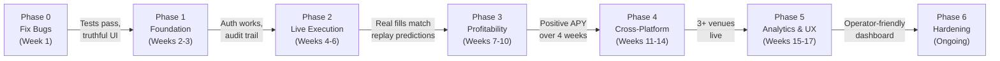

# polyarb — Plan of Action

> **Goal:** Transform polyarb from a paper-trading research toolkit into an
> **intuitive, profitable, minimal-risk, cross-platform mispricing arbitrator**.
>
> Phases are sequenced so that each one is independently useful and each
> gate must pass before the next phase begins. Effort: **S** (hours),
> **M** (days), **L** (weeks).

---

## Phase 0 — Fix What's Broken (Week 1)

> **Gate:** All tests pass. The UI shows truthful numbers. No trade is booked
> unless it has a mathematically verified positive edge after fees.

### 0.1 Fix the poller's edge calculation [S] — CRITICAL
The poller (`poller.py:192`) books trades with `unit_cost ≤ 1.02`, meaning it
books **guaranteed losses** of up to $0.02/share. Replace the hand-rolled check
with a call to `core.best_basket()` — the same function that `scanner.py` and
`replay.py` already use correctly.

```
Before:  edge = round(1.0 - total_unit_cost, 4)   # can be negative!
         (books anyway if total_unit_cost <= 1.02)

After:   bk = best_basket(kind, asks, fee_bps, fees)
         if not bk or bk.edge < cfg.risk.min_edge:
             return False
```

### 0.2 Wire risk controls into the poller [S] — CRITICAL
`scanner.py.scan_once()` correctly checks anomaly edge, approval expiry,
exposure caps, book validation, clock skew, and kill switch. The poller checks
**none** of these. Either:
- **Option A (quick):** Make the poller call `scan_once()` instead of its own
  `_evaluate_and_book_candidate()`.
- **Option B (clean):** Extract a shared `evaluate_opportunity()` function used
  by both scanner and poller.

### 0.3 Fix simulator payoff assumption [S] — HIGH
`simulator.py:172` hardcodes `payoff_usd = 1.0 * shares`. Pass the actual
`basket.payoff` from the basket search so that partition groups (payoff = 1),
exclusive groups (payoff = n−1), and void-inclusive baskets show correct numbers.

### 0.4 Include fees in the poller's sizing [S] — HIGH
Call `venues.fee_fn()` for each leg and pass fee functions into `best_basket()`
and `sweep_with_limits()`. The scanner already does this.

### 0.5 Remove template fallback [S] — HIGH
Delete the `ACTUAL_DATA_TEMPLATES` fallback path in `server.py:129` and
`simulator.py:361-466`. Stale hardcoded prices produce fictitious P&L.

### 0.6 Fix settlement realism [S] — MEDIUM
`settle_entire_structure()` defaults to `world_outcome="YES"`, inflating
realised P&L. For paper simulation, settlement should use the actual worst-case
payoff from the basket, not assume the best outcome.

---

## Phase 1 — Foundation for Live Trading (Weeks 2–3)

> **Gate:** Credential management works. The system can authenticate to both
> venues. Orders can be placed and cancelled in a sandbox/testnet. An immutable
> audit trail records every action.

### 1.1 Dependency & project setup [S]
- Create `pyproject.toml` with dependencies (`websockets`, and soon venue SDKs).
- Add `mypy` and `ruff` configs. Run in CI.
- Migrate tests to `pytest` for isolation, fixtures, and coverage.

### 1.2 Credential management [M]
- Encrypted local keystore for:
  - Polymarket: private key for EIP-712 order signing.
  - Kalshi: API key + secret for HMAC request signing.
- Environment variable override (`POLYARB_POLY_KEY`, `POLYARB_KALSHI_KEY`).
- **Never** commit keys; `.gitignore` the keystore file.

### 1.3 Venue execution adapters [L] — CRITICAL
Implement an `Executor` interface with venue-specific adapters:

```python
class Executor(Protocol):
    async def place_limit(self, market_id, side, price, size) -> OrderId: ...
    async def cancel(self, order_id) -> bool: ...
    async def get_fills(self, order_id) -> list[Fill]: ...
    async def get_balance(self) -> Balance: ...
```

- **Polymarket adapter:** CLOB limit order via REST + EIP-712 signature. Query
  fills from subgraph or REST.
- **Kalshi adapter:** REST v2 order placement with HMAC auth. Kalshi has a
  straightforward REST order API.
- Start with limit IOC (immediate-or-cancel). Add resting limits in Phase 3.

### 1.4 Immutable audit log [M]
- Append-only SQLite table: `(ts, action, venue, market_id, side, price, size,
  order_id, fill_qty, fill_price, status, raw_response_hash)`.
- Never delete or update rows. Every place, cancel, fill, and error is logged.
- Export to CSV/JSON for compliance.

### 1.5 Per-venue balance tracking [S]
- Track `balance_polymarket_usd` and `balance_kalshi_usd` separately.
- Enforce `RiskLimits.max_capital_per_venue` at booking time.
- Alert when balance on either venue drops below a threshold.

### 1.6 Structured logging [S]
- Replace all `print()` with `logging` module.
- JSON-structured log format with timestamp, level, module, correlation ID.
- File rotation + console output.

---

## Phase 2 — Safe Live Execution (Weeks 4–6)

> **Gate:** The system can place and manage real orders with hard risk limits.
> A human must approve every trade for the first N days. Live fills match
> replay predictions within tolerance.

### 2.1 Execution orchestrator [L] — CRITICAL
Central component that:
1. Receives a scored opportunity from the scanner/poller.
2. Checks all risk limits (per-relation, per-event, per-venue, global, daily
   loss).
3. Sizes using `sweep_with_limits()` with real depth.
4. Submits legs with configurable ordering (thinnest leg first by default).
5. Monitors fill status with timeout.
6. If second leg fails to fill within timeout:
   - Attempts to unwind the first leg at best bid.
   - Logs the legging loss.
   - Triggers a legging-failure circuit breaker if losses accumulate.
7. Writes all actions to the audit log.

### 2.2 Human-in-the-loop gate [M]
- For the first N trades (configurable, default 50), require explicit human
  confirmation via the UI or Telegram bot before order submission.
- Show: basket legs, edge, APY, risk flags, resolution rules side-by-side.
- After N successful trades with fill quality matching expectations, switch to
  auto-execution with alerts.

### 2.3 Fill reconciliation [M]
- After each leg fills, compare actual fill price vs. expected price.
- Log slippage. If cumulative slippage exceeds threshold, pause and alert.
- Periodically query venue balances and compare to internal ledger.

### 2.4 Kill switch enhancements [S]
- Make kill switch cancel all open resting orders across all venues.
- Add a "soft kill" mode: stop opening new positions but let existing ones
  ride to settlement.
- One-click kill from the UI, plus Telegram `/kill` command.

### 2.5 Alerting & notifications [M]
- Telegram bot (most practical for mobile):
  - Trade opened / filled / legging failure.
  - Daily P&L summary.
  - Kill switch triggered.
  - Disconnect / error spikes.
- Optional: email digest, desktop notifications.

---

## Phase 3 — Profitability Improvements (Weeks 7–10)

> **Gate:** Annualised return on deployed capital exceeds hurdle rate over a
> 4-week live window after fees, slippage, and legging losses.

### 3.1 Opportunity ranking & capital allocation [M] — HIGH
Replace first-come-first-served booking with a scoring pipeline:
1. Score each opportunity by: `risk_adjusted_edge * annualized_return_factor`.
2. Sort descending.
3. Allocate capital to the top N opportunities that fit within risk limits.
4. Rebalance every tick: if a better opportunity appears, do not exit existing
   positions (arb positions cannot be profitably unwound in general) but
   redirect remaining capital.

### 3.2 LP sizing with linear programming [M]
Replace equal-share baskets with an LP:
- Maximise guaranteed profit.
- Subject to: depth constraints per leg, capital limits per relation/event/venue,
  slippage cap.
- Can net multiple relations sharing a common leg.
- Use `scipy.optimize.linprog` or `cvxpy` (small problems, ≤50 variables).

### 3.3 Maker-side execution [L]
- Post a resting limit order on the less liquid leg.
- When filled, take the other leg immediately.
- Benefits: saves spread, may earn maker rebates.
- Risks: adverse selection, legging risk increases.
- Requires: fill notification (websocket), queue position estimation.
- Only enable after taker-side is proven profitable.

### 3.4 Wider relation coverage [M]
- **Nested events:** winning primary ⊇ winning general (sports, politics).
- **Multi-leg baskets:** 3+ markets (date × threshold grids).
- **Kalshi internal relations:** series markets on Kalshi (bracket structures).
- Prioritise categories with many structurally related markets.

### 3.5 Better matching & NLP [M]
- Use structured fields (series slug, event ticker, tags) before free text.
- Embedding-based similarity (sentence-transformers) as a ranking aid.
- Entity normalization (names, tickers, dates, thresholds).
- Always followed by human approval.

### 3.6 Dynamic FX rate [S]
- Fetch live INR/USD rate from a free API (exchangerate.host or similar).
- Cache with 1-hour TTL.
- Use in all INR calculations.

---

## Phase 4 — Cross-Platform Expansion (Weeks 11–14)

> **Gate:** At least one additional venue is integrated with order placement.
> Cross-venue edges are captured in live trading.

### 4.1 Kalshi websocket integration [M]
- Implement authenticated websocket connection for real-time orderbook updates.
- Eliminate the 5s polling bottleneck for cross-venue edges.
- Requires Kalshi API key signing for websocket auth.

### 4.2 Additional venue: Betfair / PredictIt / Manifold [L]
- Evaluate which venue has:
  - Sufficient liquidity on overlapping markets.
  - An API permitting automated trading.
  - Legal access in the operator's jurisdiction.
- Implement venue adapter (extends the `Executor` protocol from §1.3).
- Add to the matcher for cross-venue relation discovery.

### 4.3 On-chain settlement monitoring [M]
- For Polymarket: monitor conditional token resolution events on Polygon.
- Detect settlement, update position status, credit proceeds.
- For Kalshi: poll settlement status via REST.
- Reconcile cross-venue settlements: flag if one venue settles and the other
  hasn't within a tolerance window.

### 4.4 Gas & bridging cost model [S]
- Replace the flat `non_trading_cost_usd = 0.05` with:
  - Live Polygon gas price estimate.
  - Bridge cost estimate (if funding from L1).
  - Amortised deposit/withdrawal costs per trade.
- Deduct from edge calculation.

---

## Phase 5 — Analytics & UX (Weeks 15–17)

> **Gate:** A non-technical operator can monitor, approve, and manage the
> system from the dashboard alone.

### 5.1 Dashboard rewrite [L]
- Separate HTML/CSS/JS from Python (serve static files or use a lightweight
  framework like FastAPI + Jinja2 or a React SPA).
- Component structure: Header, Metrics, PositionTable, LegDetail, RelationReview.
- Mobile-responsive design.

### 5.2 Approval workflow in the UI [M]
- List candidate relations with side-by-side resolution rules.
- One-click approve / reject with notes.
- Show risk flags prominently.
- Approval expiry countdown.

### 5.3 Analytics dashboard [M]
- Edge-decay curves (how long do edges survive at various horizons).
- Episodes by category and relation type.
- Profit per capital-day, gross vs. net of fees.
- Fill quality: expected vs. actual slippage.
- Capital utilisation over time.

### 5.4 Historical performance charts [M]
- Time-series of portfolio value, cumulative P&L, win rate.
- Per-venue and per-relation-type breakdowns.
- Sharpe ratio, max drawdown, return on locked capital.

---

## Phase 6 — Hardening & Scale (Ongoing)

### 6.1 Data pipeline [M]
- Roll old `snaps` into Parquet with daily compaction job.
- Size cap + retention policy (e.g., keep 90 days of tick data, 1 year of
  daily aggregates).
- Backup `portfolio.json` → timestamped snapshots.

### 6.2 Schema migration [S]
- Use Alembic or a simple version table + migration scripts for SQLite schema
  changes. Remove the bare `except sqlite3.OperationalError` fallback.

### 6.3 CI / CD [S]
- GitHub Actions: lint, type-check, test on every push.
- Pre-commit hooks for formatting.
- Coverage threshold gate.

### 6.4 Transport hardening [M]
- Replace the manual TLS-splitting transport with a proper HTTPS client
  (httpx or aiohttp) behind a configurable proxy.
- Remove hardcoded fallback IPs.
- Add request-level retries with exponential backoff and jitter.

### 6.5 Tax & compliance [M]
- FIFO cost basis tracking per token.
- Exportable trade log (CSV) for tax reporting.
- Jurisdiction check: warn if operator's IP suggests a restricted region.

### 6.6 Multi-instance / cloud deployment [L]
- Run the scanner + executor as a service (Docker container or systemd unit).
- Separate the UI from the execution engine (API-first architecture).
- Optional: deploy near venue servers for latency reduction.

---

## Phased Milestone Summary



---

## Risk Register

| Risk | Mitigation | Phase |
|------|------------|-------|
| Edges are consumed by faster bots before we can fill | Measure fill rate vs. replay predictions; if <30% at 15s, pivot to maker-side or market-making | 2–3 |
| Resolution rules differ subtly between venues | Side-by-side rule display, mandatory human approval, auto-flag mismatches | 0–1 |
| Venue API changes break parsing | Fixture-based regression tests, `doctor` checks on startup | 1 |
| Legging risk: one leg fills, second doesn't | Unwind logic, legging-failure circuit breaker, size smaller than thinnest leg depth | 2 |
| Capital locked for months in long-dated markets | APY ranking, prefer short-dated relations, capital release via position merging | 3 |
| Regulatory / ToS violation | Jurisdiction check, legal review before live trading, conservative position limits | 1 |
| Portfolio state corruption | Atomic writes (write-then-rename), periodic backups, append-only audit log as source of truth | 1–2 |
| ISP/firewall blocks venue APIs | Proxy support (already partially implemented), VPN documentation | 0 |

---

## Immediate Next Steps (This Week)

1. **Fix the poller** (§0.1–0.4): ~4 hours of work, eliminates the "booking
   guaranteed losses" bug.
2. **Remove template fallback** (§0.5): 15 minutes.
3. **Run the existing test suite** to confirm nothing regresses.
4. **Create `pyproject.toml`** (§1.1): 30 minutes.
5. **Record 1–2 weeks of data** with `stream` on a small set of approved
   relations, then `replay` to answer the fundamental question: **is there an
   exploitable edge?**

> Everything beyond Phase 2 should be conditional on the answer to that
> question. If replay shows no edges surviving fees and realistic latency,
> the highest-ROI work is expanding relation coverage (§3.4) or pivoting
> strategy, not building more execution infrastructure.
